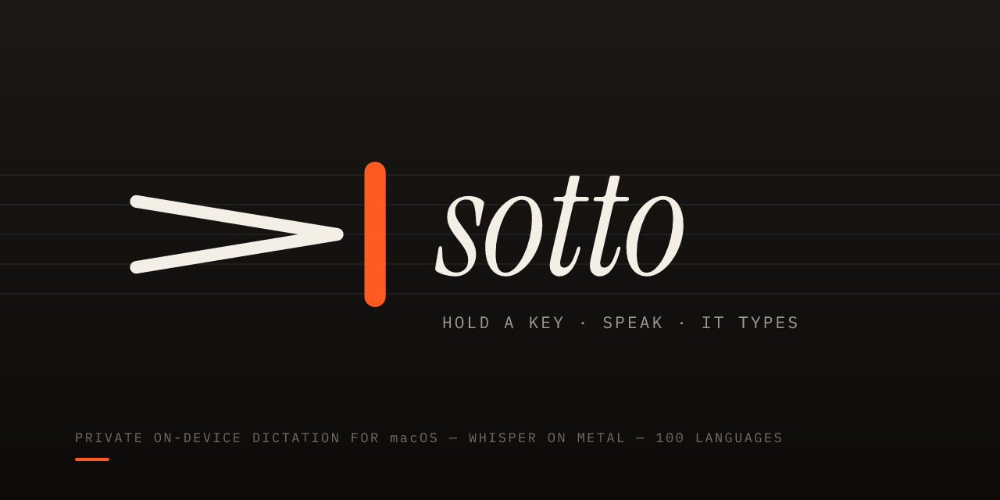
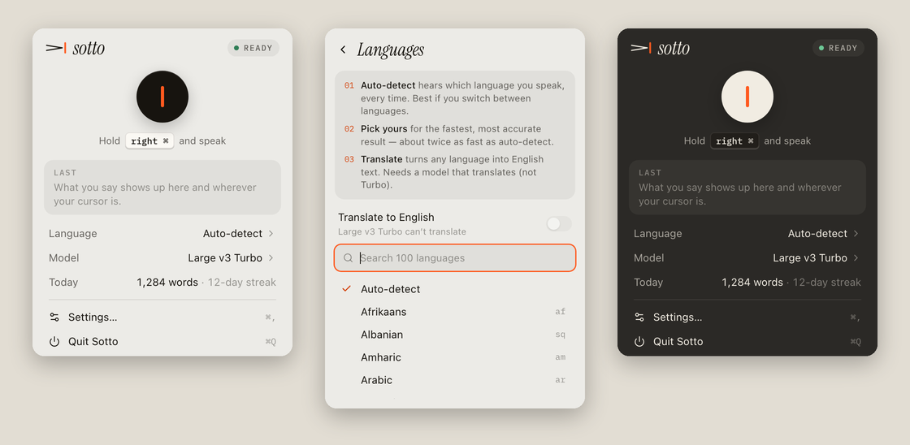
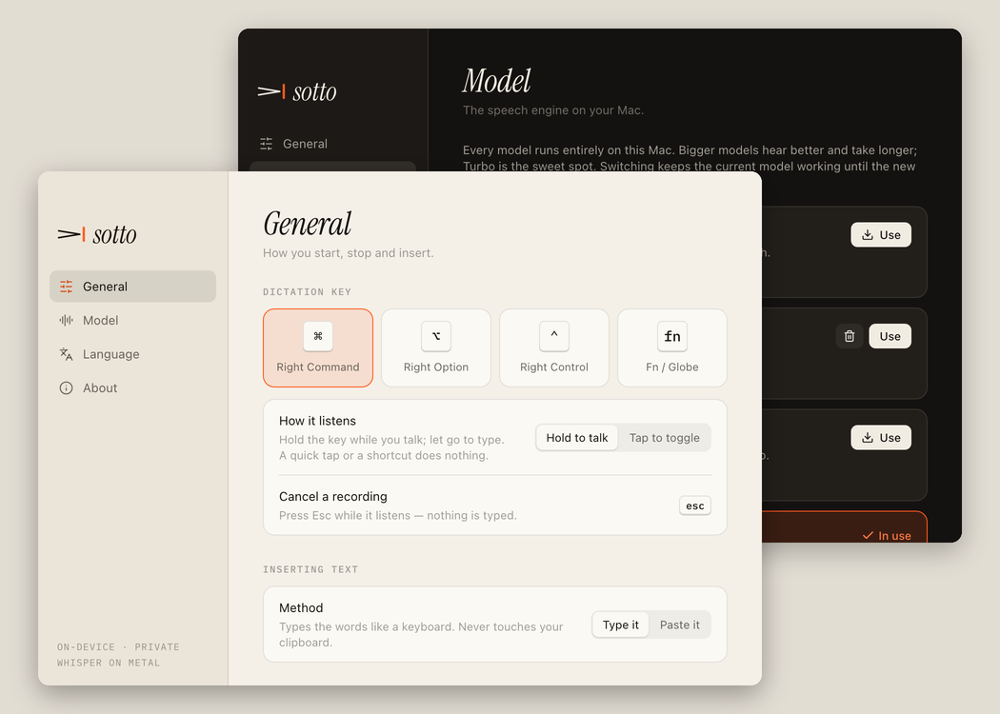

<p align="center">
  
</p>

<p align="center">
  <b>Hold a key, speak, and it types — in any app.</b><br>
  Private dictation for macOS. Whisper runs on your Mac’s GPU; your voice never leaves it.
</p>

<p align="center">
  <a href="LICENSE"></a>
  
  
  <a href="https://github.com/vladiclick/sotto/actions/workflows/ci.yml"></a>
</p>

<p align="center">
  <a href="#install">Install</a> ·
  <a href="#use">Use</a> ·
  <a href="#models">Models</a> ·
  <a href="#languages">Languages</a> ·
  <a href="#privacy">Privacy</a> ·
  <a href="#build-from-source">Build</a> ·
  <a href="#how-it-works">How it works</a>
</p>

<p align="center">
  
</p>

> *Sotto voce* — under the breath. The mark is a decrescendo hairpin, the
> music sign for “getting quieter”, fading into a text cursor.

## Why Sotto

- **Private by construction.** No account, no cloud, no telemetry. Audio is
  transcribed in memory on your Mac and dropped. The only network traffic is
  downloading the model you pick.
- **Fast on Apple Silicon.** [whisper.cpp](https://github.com/ggml-org/whisper.cpp)
  on Metal. On an M4, a 7-second sentence is transcribed in about 1.4 s with
  the language set, about 2.7 s with auto-detect.
- **Works everywhere you type.** Text lands at your cursor — typed like a
  keyboard, or pasted with your clipboard put back afterwards.
- **100 languages**, auto-detected or pinned, plus translate-to-English.
- **A key that stays out of your way.** Hold right ⌘ (or ⌥, ⌃, fn) to talk.
  A quick tap or a shortcut (⌘C, ⌘Tab…) never starts a dictation — or switch
  to tap-to-toggle for hands-free.
- **Small.** A 10 MB app plus the model you choose (31 MB to 1.1 GB).

## Install

**Download:** grab `Sotto.dmg` from [Releases](https://github.com/vladiclick/sotto/releases),
open it and drag Sotto to Applications.

> Releases are not notarized yet. The first time, right-click Sotto → **Open**
> (on macOS 15+: System Settings → Privacy & Security → **Open Anyway**).

On first launch Sotto lives in the menu bar (no Dock icon) and:

1. asks for the **Microphone** and **Accessibility** permissions — the
   panel walks you through both and updates the moment you flip the switch;
2. downloads the default model (**Large v3 Turbo**, 574 MB, checksum
   verified). You can keep working while it downloads.

Tested on macOS 26 with an Apple M4. Built for macOS 12+; Apple Silicon
strongly recommended.

## Use

| | |
|---|---|
| **Dictate** | Hold **right ⌘**, speak, let go. The text appears at your cursor. |
| **Hands-free** | Settings → *Tap to toggle*: tap once to start, tap again to finish. |
| **Cancel** | Press **Esc** while it listens — nothing is typed. |
| **Status** | The menu-bar mark turns vermilion while it listens; a small pill above the Dock shows your voice level. |
| **Panel** | Click the mark: record button, language, model, today’s words, your last dictation. |
| **Settings** | **⌘,** from the panel, or right-click the mark. |

<p align="center">
  
</p>

### Settings

| Setting | Options |
|---|---|
| Dictation key | Right ⌘ · Right ⌥ · Right ⌃ · fn/🌐 |
| How it listens | Hold to talk · Tap to toggle |
| Inserting text | Type it (never touches the clipboard) · Paste it (clipboard restored) |
| Model | 8 Whisper models, downloaded and switched in-app |
| Language | Auto-detect or any of 100 · Translate to English |
| Your vocabulary | Names and jargon Whisper should spell your way |
| Feedback | Start/stop sounds · Recording pill |
| System | Open at login |

## Models

All models run locally through whisper.cpp. They are fetched from
[huggingface.co/ggerganov/whisper.cpp](https://huggingface.co/ggerganov/whisper.cpp)
and checked against a pinned SHA-256 before first use. Switching keeps the
current model working until the new one is ready.

| Model | Size | Speed | Accuracy | Notes |
|---|---:|:---:|:---:|---|
| Tiny | 32 MB | ●●●●● | ●○○○○ | Short notes in clear English |
| Base | 60 MB | ●●●●● | ●●○○○ | |
| Small | 190 MB | ●●●●○ | ●●●○○ | Good on older Macs |
| Small · English | 190 MB | ●●●●○ | ●●●○○ | English only, sharper English |
| Medium | 539 MB | ●●○○○ | ●●●●○ | Translates |
| **Large v3 Turbo** | 574 MB | ●●●○○ | ●●●●● | **Default** — the sweet spot |
| Large v3 Turbo · HQ | 874 MB | ●●●○○ | ●●●●● | 8-bit, a touch more accurate |
| Large v3 | 1.08 GB | ●○○○○ | ●●●●● | Most accurate, translates |

## Languages

Click **Language** in the panel for a searchable list of all 100 languages
and a three-line guide:

1. **Auto-detect** hears which language you speak, every time — best if you
   switch between languages.
2. **Pick yours** for the fastest, most accurate result — about twice as
   fast as auto-detect.
3. **Translate** turns any language into English text. It needs a model that
   translates: Tiny, Base, Small, Medium or Large v3 (Turbo was trained
   without translation).

English-only models always transcribe English.

## Privacy

- The microphone opens when you press the dictation key — so your first
  word isn’t lost — and closes when you let go. A tap or a shortcut discards
  that audio without transcribing it.
- Speech is transcribed on-device. Nothing is uploaded; there are no
  analytics.
- Sotto stores word counts and the app you dictated into (for the
  “today” count and streak) in a local SQLite file. It never stores what you
  said. Logs (`~/Library/Logs/Sotto/`) never contain transcripts.
- Paste mode marks its clipboard entry as transient, so clipboard managers
  that follow the [nspasteboard.org](http://nspasteboard.org) convention
  don’t record it, and puts your previous clipboard back.

## Build from source

Requires macOS with the Xcode Command Line Tools, [Rust](https://rustup.rs)
1.82+, Node.js 20+ and `cmake` (`brew install cmake` — whisper.cpp is built
from source).

```bash
git clone https://github.com/vladiclick/sotto.git
cd sotto
npm run app:start   # builds the UI and the app, then launches Sotto.app
```

`app:start` signs with your **Apple Development** certificate if one is in
your keychain (Xcode → Settings → Accounts), so macOS keeps your permission
approvals across rebuilds. Without one it signs ad-hoc and macOS asks again
after every build.

| Command | What it does |
|---|---|
| `npm run app:start` | Release build + launch |
| `npm run app:dev` | Hot-reloading dev build |
| `npm run app:build` | Release `.app` + `.dmg` |
| `npm run ui:dev` | The UI in a browser with sample data (`/panel.html`, `/settings.html?tab=model`, `/overlay.html`) |
| `npm run check` | Type-check, `clippy -D warnings`, unit tests |
| `npm run brand` | Regenerate the logo, icon and banner from `scripts/brand.py` |

End-to-end test on a real model (f32 little-endian mono 16 kHz audio):

```bash
SOTTO_TEST_MODEL=~/Library/Application\ Support/io.github.vladiclick.sotto/models/ggml-large-v3-turbo-q5_0.bin \
SOTTO_TEST_PCM=clip.pcm SOTTO_TEST_EXPECT="What you said." \
cargo test --manifest-path src-tauri/Cargo.toml -- --ignored
```

## How it works

```
 dictation key ──► hotkey.rs ──► audio.rs ─────────► stt.rs ─────────► typing.rs ──► your app
 (CGEventTap)      hold / tap    mic → 16 kHz mono   whisper.cpp       type or paste
                   chord-safe    + live level         on Metal          at the cursor
                        │              │                  │
                        └──── dictation.rs (state machine) ──► tray glyph · overlay pill · panel
```

| File | Role |
|---|---|
| `src-tauri/src/hotkey.rs` | Listen-only event tap; hold/toggle logic; shortcut and Esc handling |
| `src-tauri/src/audio.rs` | Microphone capture, cancellable, anti-aliased resampling |
| `src-tauri/src/stt.rs` | whisper.cpp wrapper; silence and hallucination filtering |
| `src-tauri/src/typing.rs` | Typing and clipboard paste with full clipboard restore |
| `src-tauri/src/dictation.rs` | State machine; model switching without interrupting dictation |
| `src-tauri/src/models.rs` · `download.rs` | Model catalog; resumable, checksum-verified downloads |
| `src-tauri/src/settings.rs` | Validated, atomically saved preferences |
| `src-tauri/src/overlay.rs` · `panel.rs` | Recording pill; menu-bar glyph and panel |
| `src-tauri/src/system.rs` | App Nap off (it made the key miss presses), thread priority, logging |
| `ui/` | React + Tailwind: panel, Settings window, overlay |
| `scripts/brand.py` | The mark, icon and banner as code |

## Troubleshooting

- **The key does nothing.** Open the panel — it shows any missing
  permission. Settings → General → Permissions shows whether the key
  listener is running. Details are in `~/Library/Logs/Sotto/sotto.log`.
- **Nothing gets typed in one app.** Password fields and some secure apps
  block synthetic keystrokes. Try Settings → *Paste it*.
- **fn opens the emoji picker too.** System Settings → Keyboard → “Press 🌐
  key to” → *Do Nothing*.
- **Permissions asked again after an update.** Unsigned/ad-hoc builds look
  like a new app to macOS; remove the old Sotto entry under Privacy &
  Security → Accessibility and approve the new one.

## Contributing

Bug reports, translations of the docs and pull requests are welcome — see
[CONTRIBUTING.md](CONTRIBUTING.md).

## Credits

Built on [whisper.cpp](https://github.com/ggml-org/whisper.cpp) (MIT) and
OpenAI’s [Whisper](https://github.com/openai/whisper) models (MIT), with
[Tauri](https://tauri.app). Typefaces: Instrument Serif and IBM Plex Mono
(SIL Open Font License).

## License

[MIT](LICENSE) © 2026 Vladimir Coman
